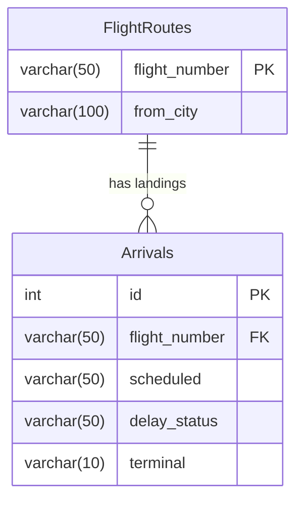

# Flight Arrivals Management System (JDBC_FlightManager)

**Course:** Software Engineering Methods (2026–2027)  
**Institution:** Braude College of Engineering  
**Department:** Software Engineering  
**Student:** Moshe Ben Shabat

---

## 1. Project Description

JDBC_FlightManager is a Java-based Data Access Layer (DAL) for an airport flight arrivals management system.

The project manages 299 flight arrival records imported from a CSV file into a MySQL database.

The original database was normalized into Third Normal Form (3NF) using two related tables: FlightRoutes and Arrivals.

The system supports the following operations:

- Display all 299 flight arrivals using INNER JOIN.
- Update the delay status of a specific flight.
- Update multiple arrival records using batch operations.
- Filter and display flights by terminal number.
- Demonstrate an SQL Injection vulnerability.
- Prevent SQL Injection using PreparedStatement.

The project was developed individually with AI assistance and special permission from the course instructor.

---

## 2. Engineering Team Details

**Development Model:** Individual development with instructor approval.

| Field | Details |
|---|---|
| Student Name | Moshe Ben Shabat |
| Student ID | [FILL IN - PRIVATE SUBMISSION ONLY] |
| Academic Email | [FILL IN] |
| Group Number | GXX (Temporary) |
| GitHub Repository | [ADD GITHUB LINK LATER] |
| Submission ZIP | GXX_Ex3.zip |

The project was developed individually by Moshe Ben Shabat, with AI assistance through ChatGPT and special approval from the course instructor.

The group number and GitHub repository URL will be updated before final submission.

---

## 3. Technology Stack

The following technologies were used:

- Programming Language: Java 25
- JDK: BellSoft Liberica Full JDK 25 LTS
- IDE: IntelliJ IDEA
- Database Server: MySQL Server 8.0.46
- JDBC Driver: MySQL Connector/J 9.5.0
- Database Tools: IntelliJ Database Console
- AI Assistant: ChatGPT (Instructor Approved)
- Version Control: Git
- Repository Hosting: GitHub (To Be Added)

### Java Classes

**FlightManagerBase.java**

Connects to MySQL using JDBC and displays all 299 flight arrivals by performing an INNER JOIN between FlightRoutes and Arrivals.

**SimpleFlightUpdater.java**

Allows the user to update the delay status of flight LX354. The initial implementation used an intentionally vulnerable Statement, which was later replaced by a secure PreparedStatement.

**AdvancedFlightDispatcher.java**

Uses PreparedStatement and batch execution to update multiple flight arrival records.

The program successfully updated arrival IDs 1, 3, and 5 to "Landed - Final".

**FlightViewer.java**

Allows the user to enter a terminal number (2, 3, 4, or 5) and displays all matching flights ordered by scheduled arrival time.

Testing Terminal 3 returned 55 matching flights.

---

## 4. Database Normalization (3NF) & Functional Dependencies

### 4.1 Original Database Structure

The original CSV file, arrived_flights.csv, contained 299 flight records.

It was imported into a temporary table named rawflights.

The original columns were:

- scheduled
- flight
- fromC
- delay
- terminal

### 4.2 Functional Dependency

The functional dependency identified in the exercise was:

flight -> fromC

This means that the flight number determines the departure city.

Keeping departure city information in the original flat table can create redundancy when the same flight appears in multiple arrival records.

This may cause update, insertion, and deletion anomalies.

### 4.3 Normalization to Third Normal Form (3NF)

To address these issues, the database was decomposed into two tables.

**Table 1: FlightRoutes**

- flight_number VARCHAR(50) PRIMARY KEY
- from_city VARCHAR(100) NOT NULL

This table stores flight route information.

**Table 2: Arrivals**

- id INT AUTO_INCREMENT PRIMARY KEY
- flight_number VARCHAR(50) NOT NULL
- scheduled VARCHAR(50)
- delay_status VARCHAR(50)
- terminal VARCHAR(10)

A foreign key connects Arrivals.flight_number to FlightRoutes.flight_number using ON DELETE CASCADE.

### 4.4 Migration Results

After creating the normalized tables, the original data was transferred using SQL INSERT and SELECT commands.

The migration results were:

- FlightRoutes: 299 records
- Arrivals: 299 records
- INNER JOIN: 299 matching records

The migration was verified successfully.

After verification, the original rawflights table was deleted.

The normalized structure separates route information from arrival event information and improves database consistency.

---

## 5. Independent AI Prompt - FlightViewer.java

The following English prompt was used to generate the FlightViewer class:

```text
Create a Java class named FlightViewer with a main method.
Connect to the MySQL database FlightDB using JDBC, DriverManager, and try-with-resources.
Ask the user for the MySQL root password and a terminal number (2, 3, 4, or 5) using Scanner.
Use a secure PreparedStatement with a ? parameter.
Execute an INNER JOIN between Arrivals and FlightRoutes using flight_number.
Filter by Arrivals.terminal = ? and sort the results by Arrivals.scheduled ASC.
Use pstmt.setString(1, terminal), since terminal is VARCHAR(10).
Print all matching flights in a readable format and show the total number of results.
Handle SQLExceptions appropriately.
```

### Execution Results

The program was tested using Terminal 3.

The result was:

Total flights found: 55

The program displayed the matching flights in ascending order of scheduled arrival time.

The PreparedStatement used parameter binding to prevent SQL Injection.

---

## 6. Entity Relationship Diagram (ERD)

The database consists of two tables connected by a one-to-many relationship.



### Relationship Explanation

FlightRoutes stores the route information for each unique flight number.

Arrivals stores individual arrival events.

Each arrival record references one flight route.

A flight route may be associated with multiple arrival events.

The relationship is implemented using a foreign key.

---

## 7. Security Audit Summary

### 7.1 SQL Injection Vulnerability

The initial SimpleFlightUpdater.java implementation used a standard Statement and SQL string concatenation.

The user's input was inserted directly into the SQL query.

The following attack payload was tested:

```text
Landed' #
```

The single quote closed the SQL string, while the # character started a MySQL comment.

As a result, the WHERE condition was ignored and every arrival record was updated.

### Attack Result

Before security refactoring:

```text
Rows updated: 299
```

All 299 flight arrival statuses were changed to "Landed".

This demonstrated a successful SQL Injection attack against the intentionally vulnerable application.

### 7.2 Security Refactoring

The vulnerable Statement was replaced with a secure PreparedStatement.

The corrected implementation uses SQL parameter placeholders (?) and setString() to bind user input.

This separates user input from SQL query syntax.

The class also includes Javadoc explaining the original vulnerability and the security improvement.

### 7.3 Security Verification

The arrival statuses were restored from a backup before testing the corrected application.

The same attack payload was entered again:

```text
Landed' #
```

After security refactoring:

```text
Rows updated: 1
```

Only flight LX354 was updated.

The input was treated as a literal string instead of executable SQL syntax.

The other 298 records remained unchanged.

The results demonstrate that the SQL Injection vulnerability was successfully mitigated.

---

## 8. License

Distributed under the Braude College Academic License.

Course: Software Engineering Methods (2026–2027).

This project was developed for educational purposes at Braude College of Engineering.

Any distribution or reuse must comply with the college's academic requirements.
